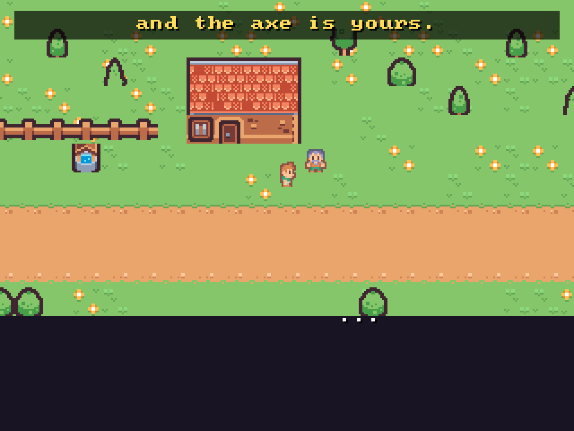
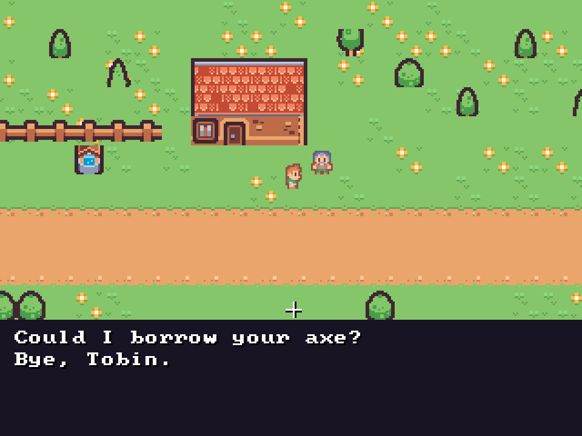
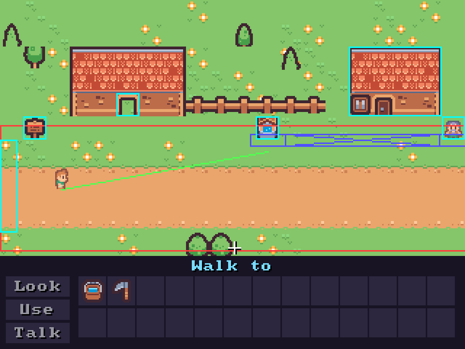
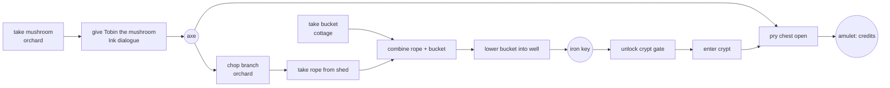

# quest-engine

A short, complete point-and-click adventure, *The Keeper's Amulet*, built on a small C++17/SDL2
engine of my own. It has four rooms and one puzzle chain, Ink dialogue, and Tiled maps that
hot-reload while the game runs. A solver proves the game can always be finished.

**Play it in the browser: https://other-now.github.io/quest-engine/**
([watch the walkthrough](https://other-now.github.io/quest-engine/?script) ·
[with the debug overlay](https://other-now.github.io/quest-engine/?script&debug))

| | |
|---|---|
|  |  |
| Camera follows the player across a two-screen room; Tobin speaks in his colour | Dialogue choices from Ink, read by inkcpp |
|  | |
| F2 debug overlay: walkable polygon (red), visibility graph between obstacle corners (blue), current A* path (green), hotspots (cyan) | |

## What's in it

| Area | What it does | Where |
|---|---|---|
| Game loop | Fixed 60 Hz timestep with an accumulator (catch-up capped at 5 steps), decoupled from rendering | `src/frontend/main.cpp` |
| Rendering | Tile layers, props and the player sorted by the y-coordinate of their feet, foreground layers, a follow camera with clamping, 4-direction walk animation, fades between rooms | `src/frontend/renderer.cpp`, `src/core/game.cpp` |
| Point-and-click | Look / Use / Talk verbs, hotspots, walk-then-act, an inventory with item combination, cursor states (normal, over a hotspot, carrying an item, busy), room transitions | `src/core/game.cpp` |
| Pathfinding | A* over the visibility graph of the walkable polygon's corners: the outer polygon's concave corners plus the obstacle holes' convex corners. Clicks outside the area clamp to its edge | `src/core/pathfind.cpp` |
| Narrative | Dialogue written in [Ink](https://github.com/inkle/ink) and compiled by inklecate/Inky. At load time [inkcpp](https://github.com/JBenda/inkcpp) turns the JSON into its binary format and runs it | `assets/dialogue/*.ink`, `src/core/dialogue.cpp` |
| Content | Rooms are Tiled `.tmj` maps: tile layers, props, hotspots, walkable polygons and spawn points. Rules are in `game.json`. Both hot-reload | `assets/` |
| State | One store of named integers holds every flag, counter and inventory slot (`has_<item>`). The rules, Ink, saves, replays and the solver all read and write it | `src/core/store.hpp` |
| Saves | JSON with a format version (now 2) and a step-by-step migration chain; content renames per revision are applied on load | `src/core/save.cpp` |
| Replay | A recording is just clicks and their tick numbers. Replaying from a new game reproduces the final state hash exactly | `src/core/replay.cpp` |
| Solver | Searches every reachable game state. Proves the game is completable and lists any dead ends with the shortest way into each | `src/core/solver.cpp`, `tools/qe_solve.cpp` |
| Builds | Windows (MSVC), Linux (GCC, Clang), macOS (Apple Clang, arm64), web (Emscripten → WebAssembly, GitHub Pages) | `.github/workflows/ci.yml` |

The engine is split in two. `qe_core` holds the whole game: sim, rules, pathfinding, Ink, saves,
replay and solver. It has **no SDL dependency**. The SDL2 frontend only reads the core's state to
draw it and passes clicks in. That split is why CI can play the game from start to credits
without a display, and why the solver and replays run the same code a player does.

```
            clicks (x, y, tick)                                 read-only
 SDL2 frontend ────────────────▶  Game::tick()  (60 Hz)  ◀──────────────── Renderer
 bot (walkthrough script) ─────▶    ├─ rules table (game.json)  ◀────────── solver (BFS over states)
 replay file ──────────────────▶    ├─ Store  ◀──── sync ────▶ Ink (inkcpp)
                                    └─ Pathfinder (visibility graph + A*)
```

## Results

Measured on an i5-9300H laptop (Windows 11, SDL's Direct3D 9 renderer, 60 Hz panel) and on GitHub Actions.

| What | Result |
|---|---|
| Solver | **246 reachable states, 748 transitions, 0 dead ends**. Completable; the shortest solution is 19 moves. Takes 14–15 ms native (Linux CI), 129 ms as wasm under node |
| Walkthrough in CI | 24 script lines → 72 clicks, 3,621 ticks (60.4 s of game time), start to credits, on every push |
| Cross-platform determinism | One recording, made on Windows/MSVC, replays to the **same final state hash** (`f5a324bf…`) on Linux GCC, Linux Clang, macOS arm64 (Apple Clang) and WebAssembly (node) |
| Desktop frame time (3 runs, full walkthrough, ~3,650 frames each) | work p50 **0.14 ms**, p99 **0.7–0.9 ms**; frame interval p50 16.66 ms, p99 18.0–18.1 ms (60 fps, vsync) |
| Browser frame time (Chrome 155, live Pages build, 3 runs) | work p50 **0.1–0.2 ms**, p99 **0.4–0.5 ms**; interval p50 16.6–16.7 ms, p99 17.1–17.2 ms (60 fps) |
| Sim cost (headless replay) | 0.03–0.04 µs per tick: rendering is all of the frame cost |
| Tests | 29 unit/integration tests, 137 checks, plus solver, walkthrough and replay as separate CTest cases, on all 5 CI targets |
| Pathfinding property test | 522 random paths across 3 polygons (U shape, room with a hole, comb with 2 holes): every path matches an exact Dijkstra over *all* polygon vertices to within 0.01 px, and every leg stays inside the area |

"Work" is the CPU time to simulate and build one frame's draw calls, measured from the top of
the frame to just before `SDL_RenderPresent`. SDL flushes its batch to the GPU in `Present` and
waits for vsync there, so the GPU's time is not in this number. The "interval" column is the
real frame-to-frame time.

## The solver

A solver state is `(room, every store variable)`. From each state it tries every move the
engine allows:

* every rule that fires on a visible hotspot in the current room, with no item or with any held item;
* every item combination;
* every branch of any conversation a rule starts. These are explored by **running the real Ink
  story** down each choice path, so a writer's change to the `.ink` can't break the game without
  the solver seeing it.

Forward BFS finds the shortest solution. A backward search from the winning states then marks
everything that can still win. Any reachable state that can't win is a **dead end**, and the
report gives the move that led into it and the shortest script that gets there:

```
$ qe-solve assets
The Keeper's Amulet: 246 reachable states, 748 transitions, 6 winning states (15 ms)
completable: yes
shortest solution: 19 moves
dead-end states: 0 (0 ways in)
```

The shipped content has none. A test plants a plausible one, "use mushroom on trees" (feed the
only mushroom to the squirrels), and the solver flags it and names that exact move. Another test
removes the rope + bucket combination and checks that the game is reported unwinnable. The
solver's shortest solution is also fed to the bot and played through the real engine, so solver
and engine can't quietly disagree.

What it assumes: walking between hotspots is always possible. `lintContent()` checks that
separately with the real pathfinder: every hotspot's walk-to point must be walkable and reachable
from every spawn point. It also checks that every Ink knot a rule names exists. CI fails on any
lint problem, an unwinnable game, or any dead end.

Puzzle chain (generated graph: `qe-solve assets --dot docs/puzzle.dot`):



## Ink and the shared store

The writer works in Inky. The engine loads the JSON that Inky or inklecate exports, and CI
recompiles the `.ink` with inklecate 1.1.1 to check that the shipped JSON is up to date.

The contract between the writer and the engine is short:

* Any Ink `VAR` whose name matches a store variable is synced. It is pushed into Ink when a
  conversation starts and read back after every line and choice. Inventory is just
  `has_<item>`, so `~ has_axe = 1` in Ink gives the player the axe.
* Each conversation starts with fresh Ink globals. **Once-only choices therefore reset between
  conversations**, so anything that must persist goes in a synced variable
  (`{not asked_crypt}`), never in Ink's visit counts. This keeps all progression state in one
  place where saves, replays and the solver can see it.
* `#speaker:name` tags pick who is talking.

`tests/data/features.ink` covers each Ink feature the game uses, and `tests/test_dialogue.cpp`
checks inkcpp against it: knots, stitches, labelled gathers, once-only and sticky choices,
conditional choices and text, assignment, `INCLUDE` and tags.

## Determinism and replay

The sim is a pure function of (state, clicks this tick). It has no wall-clock time and no
unseeded randomness; Ink's RNG is seeded, and the content uses no shuffles. Recordings are text:

```
QRP 1
content b83f259a21c63fbe  # FNV-1a of every content file
click 505 160 186      # tick, x, y in 320x240 logical coordinates
...
end 3621
final f5a324bfcf542051 # FNV-1a over tick, room, store, position/camera float bits, mode, ...
```

Float positions are hashed **by bit pattern**, so "replays the same" means bit-identical, not
"close". GCC and Clang build the core with `-ffp-contract=off`, so a compiler can't fuse `a*b+c`
into an FMA, which rounds differently. MSVC's default `/fp:precise` doesn't contract. (The
recording matched on arm64 before that flag existed; the flag is there so it doesn't depend on
which expressions the compiler happens to fuse.)

The walkthrough bot turns script lines (`use rope_bucket well`, `talk tobin`, `choose 2`) into
the clicks a player would make. It clicks verb buttons, inventory slots and hotspot centres,
walks hotspots on screen first when the camera can't see them, and clicks through dialogue.
It then records those clicks.

## Saves

```json
{ "format": 2, "content_rev": 1,
  "meta":   { "title": "...", "room": "village", "play_time_s": 24.85 },
  "player": { "room": "village", "x": 12.0, "y": 136.0, "facing": 3 },
  "tick": 1491, "vars": { "has_mushroom": 1, "...": 0 } }
```

* **Format changes:** `migrateSave()` upgrades one version at a time (v1 → v2 grouped the player
  fields and added `meta`). `tests/data/save_v1.json` was written by the v1 code (commit `9e01d7a`).
  A test loads it, finishes the game from it, and checks that re-saving writes v2.
* **Content changes:** `game.json` can list variable renames per content revision, and older saves
  are carried forward. Unknown variables are dropped; new ones get their default values.
* A test saves after every walkthrough command, loads into a fresh game, checks the round trip is
  lossless, and finishes the game from there.

## Build and run

```sh
# Linux / macOS (needs SDL2: apt install libsdl2-dev / brew install sdl2)
cmake -S . -B build -DCMAKE_BUILD_TYPE=Release && cmake --build build -j
./build/quest                          # play (run from the repo root, or pass --assets DIR)
ctest --test-dir build                 # tests + solver + walkthrough + committed replay

# Windows (MSVC): download SDL2-devel-2.32.10-VC.zip from libsdl-org/SDL releases
cmake -S . -B build -A x64 -DSDL2_DIR=C:/path/SDL2-2.32.10/cmake
cmake --build build --config Release

# Web (Emscripten 3.1.74)
emcmake cmake -S . -B build-web -DCMAKE_BUILD_TYPE=Release && cmake --build build-web
# -> build-web/index.html, index.js, index.wasm, index.data

# Headless tools
./build/qe-solve assets [--emit-walkthrough FILE] [--dot FILE]
./build/qe-headless assets --script assets/walkthrough.txt --record run.qrp --expect-win
./build/qe-headless assets --replay tests/data/walkthrough.qrp --sim-bench 50
./build/quest --script assets/walkthrough.txt --bench     # watch it + desktop frame times
python tools/browser_bench.py https://other-now.github.io/quest-engine/   # browser frame times
```

In-game keys: **F2** debug overlay, **F5** save, **F9** load, **Esc** quit. Right-click cancels the current verb or item.

**Authoring:** open `assets/rooms/*.tmj` in Tiled, or edit `assets/game.json`, and save. The running
game reloads within half a second and keeps your progress; if the new file is broken, it keeps the
old content and prints the error. Dialogue: edit `assets/dialogue/*.ink`, then run
`tools/compile_ink.sh` (or Export to JSON in Inky). `tools/make_rooms.py` made the first draft of the
maps; the `.tmj` files are now the source of truth.

## Not done / limits

* **Maps were generated, not hand-drawn in Tiled.** They are standard Tiled JSON and open in Tiled,
  but the first layout came from a script, and I haven't round-tripped them through Tiled's editor
  on this machine.
* One walkable polygon per room, and it can't change at runtime: a cleared obstacle doesn't open new floor.
* No audio, no perspective scaling of the player sprite, no NPC walking or animation (Tobin is a prop).
* Web saves (F5) live in Emscripten's in-memory file system and don't survive a page reload.
* Hot reload is desktop only. Reloading in the middle of a conversation ends the conversation.
* The solver models Ink state only through synced variables, which is the contract above. It
  de-duplicates dialogue branches on (variables, visible choices), so a story that hides
  progression inside Ink visit counts could be under-explored.
* Frame-time numbers are for this very light scene (a few hundred sprites at 320×240). They
  show the engine leaves the frame budget idle, not how it would scale.

## Credits and licences

* Code: MIT (see `LICENSE`).
* Art: [Kenney](https://kenney.nl) *Tiny Town* 1.1, *Tiny Dungeon* 1.0 and *RPG Urban Pack* 1.0, all **CC0 1.0**
  (licence files in `assets/licenses/`).
* [inkcpp](https://github.com/JBenda/inkcpp) v0.1.12 (MIT), fetched at build time.
  [Ink](https://github.com/inkle/ink)/inklecate by inkle (MIT).
* [SDL2](https://libsdl.org) (zlib). [nlohmann/json](https://github.com/nlohmann/json) 3.11.2 (MIT).
  [stb_image](https://github.com/nothings/stb) (public domain / MIT).
  [font8x8](https://github.com/dhepper/font8x8) (public domain; changed `char` to `unsigned char` so it compiles as C++).
